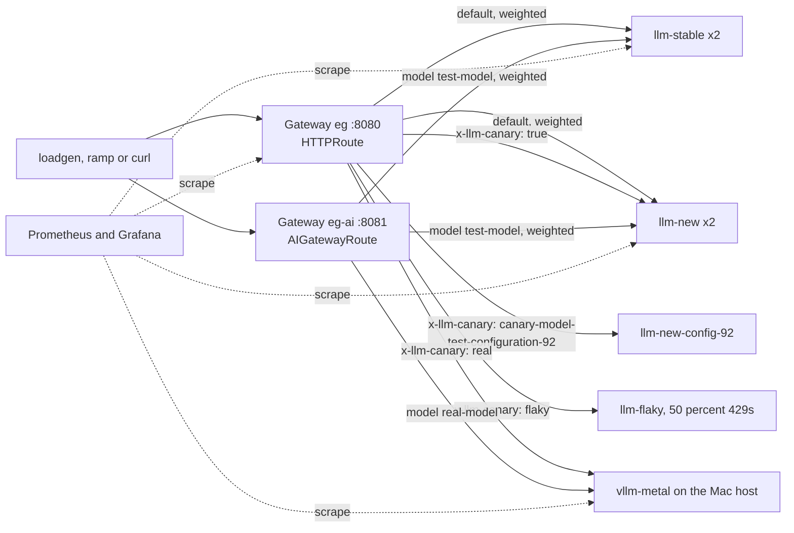
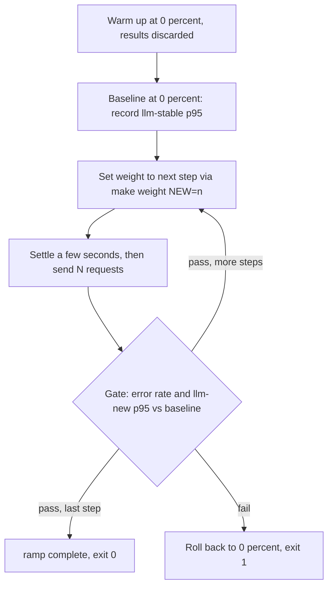

# llm-canary-lab

A local Kubernetes lab for learning and testing how to shift traffic safely from an existing LLM cluster to a new one.
Everything runs on one Apple Silicon Mac (sized for 64 GB). You get a real Envoy-based gateway, real routing, real retries
and real Prometheus/Grafana metrics, in front of either simulated LLM backends or one real model running on your Mac.

If you have never touched Gateway API, Envoy Gateway or canary rollouts, this README is written so you can start from zero.
If you only want commands, jump to [Quickstart](#quickstart).

## Contents

1. [What this is for](#what-this-is-for)
2. [Concepts you need](#concepts-you-need)
3. [What is in the box](#what-is-in-the-box)
4. [Architecture](#architecture)
5. [Prerequisites and sizing](#prerequisites-and-sizing)
6. [Quickstart](#quickstart)
7. [How routing works here](#how-routing-works-here)
8. [The two scripts](#the-two-scripts)
9. [Scenarios (guided tour)](#scenarios-guided-tour)
10. [Experiments to try next](#experiments-to-try-next)
11. [Observability](#observability)
12. [Using the real model](#using-the-real-model)
13. [Knobs](#knobs)
14. [kubectl cheat sheet](#kubectl-cheat-sheet)
15. [Troubleshooting](#troubleshooting)
16. [Suggested learning path](#suggested-learning-path)
17. [Versions](#versions)
18. [Verified and not verified](#verified-and-not-verified)
19. [Repository layout](#repository-layout)
20. [Development](#development)
21. [Teardown](#teardown)
22. [Further reading](#further-reading)

## What this is for

The question this lab answers: **"We have a new LLM serving cluster (new model, new GPUs, new config). How do we move
production traffic onto it without finding out about problems from our users?"**

It lets you practise, repeatably and cheaply, the whole progressive-delivery loop:

- send a **named test configuration** to the new cluster using a header, with zero production exposure
- **mirror** live traffic to the new cluster to compare behaviour while users still get the old answers
- **shift a percentage** of real traffic (5, 25, 50, 100) and watch latency and errors per backend
- let a script **gate** each step on error rate and p95 latency, and **roll back automatically** if the gate fails
- see what **retries do and do not mask** when a backend fails
- route on the **model name** inside the request body (the AI-aware gateway), not just on headers
- put a **real model** (vllm-metal on Metal) behind the same gateways and compare it to the simulator

It is a learning rig, not a production blueprint. The simulated backends are deliberately simple so that the interesting
part, the gateway behaviour and your measurements of it, is the only thing that changes.

### Goals

- A one-command-ish path from an empty machine to a working gateway, backends, metrics and dashboard.
- Every routing feature demonstrated by a copy-pasteable `make` target.
- Backends that are slow or flaky on demand, so gates have something to catch.
- Numbers you can trust to compare: per-backend request counts, p50/p95 latency and time to first token.
- A place to test the same rollout logic against both a plain gateway and an AI-aware gateway.

### Non-goals

- Measuring real model quality or real GPU performance. Simulator latency is configured, not measured.
- Production hardening (TLS, auth, multi-tenant rate limiting, HA control plane).
- Replacing Flagger or Argo Rollouts. `ramp.py` is a teaching-sized gate loop, not a rollout controller.

## Concepts you need

You can skim this and come back as terms appear.

| Term | Plain meaning |
| --- | --- |
| **Canary** | Send a small, controlled slice of traffic (or only your own test traffic) to the new thing first. Named after the canary in the coal mine: if it is going to fail, it fails first and small. |
| **Progressive traffic shift** | Move traffic in steps (5 percent, 25, 50, 100), checking health between steps. |
| **Header canary** | Only requests carrying a chosen header, for example `x-llm-canary: true`, reach the new backend. Zero exposure for everyone else. Good for testers and smoke tests. |
| **Weighted routing** | The gateway picks a backend at random per request in proportion to weights (for example 90/10). Good for real traffic shifts. |
| **Mirroring (shadowing)** | The gateway sends a copy of each request to the new backend and throws the copy's response away. Users only see the old backend's answer. Shows how the new backend copes with real traffic at no user risk, but it does double the load and cannot show you response differences to users. |
| **Gate** | An automated check between steps. If error rate or latency is worse than a threshold, stop and roll back. |
| **p50 / p95** | The median and 95th percentile latency. p95 is the number a slow tail of users feels. |
| **TTFT** | Time to first token. For streamed LLM output, how long until the first byte of the answer arrives. Often what users perceive as "latency". |
| **Gateway API** | The Kubernetes standard (`Gateway`, `HTTPRoute`, `GatewayClass`) for describing traffic routing. Replaces Ingress. |
| **Envoy Gateway** | An implementation of Gateway API that runs Envoy proxies and configures them from those resources. |
| **Agent Router (Envoy AI Gateway)** | An extension to Envoy Gateway that understands LLM APIs: it reads the `model` field from the JSON body and can route on it. Adds `AIGatewayRoute` and `AIServiceBackend`. Same project under two names: it was renamed from Envoy AI Gateway to Agent Router, but the charts, CRD group and many docs still use the old name (see [Versions](#versions)). |
| **kind / Colima** | kind runs a Kubernetes cluster as Docker containers. Colima provides the Linux VM and Docker daemon on macOS that kind needs. |
| **Inference simulator** | `llm-d-inference-sim`: a fake OpenAI-compatible server with configurable latency, streaming, metrics and failures. |
| **vllm-metal** | vLLM running on Apple Silicon through MLX/Metal. A real (small) model, but it can only run on the Mac host, not inside the Linux VM. |

## What is in the box

| Piece | Where | What it does |
| --- | --- | --- |
| kind cluster | `kind/cluster.yaml` | One control plane and two workers, inside the Colima VM. |
| Envoy Gateway | `helm/envoy-gateway-values.yaml` | The Gateway API implementation. Values file wires its extension hooks to the AI controller. |
| Agent Router / AI Gateway | installed by `make ai` | Adds model-aware routing. |
| Prometheus and Grafana | `helm/kube-prometheus-stack-values.yaml`, `manifests/40-monitoring.yaml`, `manifests/60-dashboard.yaml` | Scrapes backends and Envoy, ships a provisioned "LLM canary lab" dashboard. |
| Gateways | `manifests/10-gateway.yaml` | `eg` (plain, :8080) and `eg-ai` (AI-aware, :8081), plus a body-size buffer policy. |
| Backends | `manifests/20-backends.yaml` | `llm-stable`, `llm-new`, `llm-new-config-92`, `llm-flaky`, all simulators with different latency or failure settings. |
| Plain route | `manifests/30-route.yaml` | Header canaries, weighted default rule, retry policy. |
| AI backends and route | `manifests/50-ai-backends.yaml`, `manifests/55-ai-route.yaml` | Same stable/new pair seen through `AIGatewayRoute`. |
| Real model wiring | `real/host-backend.yaml.tpl` | Routes to vllm-metal on the Mac host. Rendered by `make real`. |
| `loadgen.py` | `scripts/` | Concurrent load with a per-backend report. |
| `ramp.py` | `scripts/` | Automated stepped ramp with gates and rollback. |
| Tests | `tests/` | Unit tests for both scripts. |

The backends differ on purpose so the metrics can tell them apart:

| Backend | TTFT | Inter-token latency | Replicas | Notes |
| --- | --- | --- | --- | --- |
| `llm-stable` | 200 ms | 20 ms | 2 | The baseline. |
| `llm-new` | 300 ms | 30 ms | 2 | About 1.5x slower than stable. The "regression" a gate should catch. |
| `llm-new-config-92` | 250 ms | 25 ms | 1 | Target of the long exact-match header canary. |
| `llm-flaky` | 200 ms | 20 ms | 1 | Returns HTTP 429 on 50 percent of requests. |
| vllm-metal (optional) | real | real | host process | Real MLX model on your Mac. |

## Architecture



How a gated ramp works (`make ramp`):



Two things to notice:

- The ramp script does not talk to Envoy directly. It shells out to `make weight` (or `make ai-weight`), which JSON-patches
  the live route's weights with `kubectl`. Everything it does you can do by hand.
- Clients reach the gateways through `kubectl port-forward` (kind has no load balancer), so `make forward` must be running.

## Prerequisites and sizing

- Apple Silicon Mac, macOS, about 64 GB RAM recommended
- [Homebrew](https://brew.sh) (for `make tools`)
- Free ports: 8080, 8081, 9090, 3000 (and 8001 if you run the real model)

`make tools` installs: `colima docker kind kubectl helm uv`.

Budget: the Colima VM gets 8 CPU and 24 GB RAM and 60 GB disk (`CPUS`, `MEM_GB`, `DISK_GB`). That leaves about 40 GB for
macOS and vllm-metal. vllm-metal defaults to claiming 90 percent of memory, so `make host-serve` caps it with
`MEM_FRACTION` (default 0.4). These are rough budgets, not measurements. On a smaller Mac, lower `MEM_GB` and `CPUS`, for
example `make vm CPUS=4 MEM_GB=12`, and skip the real model.

## Quickstart

```bash
make tools       # brew install colima docker kind kubectl helm uv
make install     # git hooks and Python deps (uv sync --extra dev)
make vm          # Colima VM; your own docker context is not switched (the Makefile sets DOCKER_CONTEXT=colima for its commands)
make up          # kind, Envoy Gateway, Agent Router, Prometheus and Grafana, then the manifests
make forward     # LEAVE RUNNING in its own terminal: :8080 :8081 :9090 :3000
```

In a second terminal:

```bash
make smoke       # which backend answers for each routing header
make load        # 200 requests, 20 at a time, report per backend
make ramp        # automated stepped ramp (the default strict gate FAILS and rolls back, on purpose)
```

Open Grafana at http://localhost:3000 (admin / admin) and the "LLM canary lab" dashboard. Prometheus is at
http://localhost:9090.

`make help` lists every target, grouped. `make reset` puts both routes back to their manifest state (weights 100/0, no
mirror, no real-as-new swap). `make status` shows gateways, routes, backends and pods.

First `make up` pulls several images and charts and takes a while (the monitoring stack has a 10 minute timeout). It is
idempotent, so re-running after a failure is safe.

### Smoke test: what good looks like

`make smoke` should print one line per probe: HTTP status, the `x-served-by` name and, in brackets, the simulator pod from
`x-inference-pod`.

| Probe | Expected backend |
| --- | --- |
| no header | `llm-stable` |
| `x-llm-canary: true` | `llm-new` |
| `x-llm-canary: canary-model-test-configuration-92` | `llm-new-config-92` |
| `x-llm-canary: flaky` | `llm-flaky` (about half the time you will see 429 instead of 200 over repeated tries) |

If those four are right, the cluster, gateway, routes and backends are all working.

## How routing works here

### Plain gateway (`eg`, :8080), `manifests/30-route.yaml`

One `HTTPRoute` named `llm` with four rules:

| Index | Match | Backend |
| --- | --- | --- |
| 0 | header `x-llm-canary: canary-model-test-configuration-92` | `llm-new-config-92` |
| 1 | header `x-llm-canary: true` | `llm-new` |
| 2 | header `x-llm-canary: flaky` | `llm-flaky` |
| 3 | (default) path prefix `/v1` | `llm-stable` weight 100, `llm-new` weight 0 |

- **Precedence.** Gateway API ranks rules, it does not take them in file order. Rules with more header matches win over the
  header-less default, which is why the canaries beat rule 3 regardless of order.
- **Rule index matters.** `make weight` and `make mirror-on` patch rule index 3 by number (`DEFAULT_RULE`). If you add or
  reorder rules in `30-route.yaml`, update `DEFAULT_RULE` or the patches will hit the wrong rule.
- **Attribution.** Each rule sets a `x-served-by` response header, so clients can tell which backend answered. The
  simulator also adds `x-inference-pod`, and `loadgen.py` falls back to that (stripping the pod hash suffix).
- **Retries.** `BackendTrafficPolicy llm-policy` retries up to 2 times, only on `connect-failure` and `refused-stream`, with
  a 300 s request timeout. It deliberately does not retry on 429 or 5xx: once a response has started, replaying it is
  unsafe for LLM streaming and non-idempotent calls.
- **Buffer limit.** A `ClientTrafficPolicy` raises Envoy's default 32 KiB buffer to 50 MiB because LLM bodies are large.

### AI gateway (`eg-ai`, :8081), `manifests/55-ai-route.yaml`

One `AIGatewayRoute` named `ai-llm`:

| Index | Match | Backend |
| --- | --- | --- |
| 0 | body `model` = `test-model` (surfaced as header `x-ai-eg-model`) | `ai-llm-stable` weight 100, `ai-llm-new` weight 0 |
| 1 | the same model match plus `x-llm-canary: true` | `ai-llm-new` |

- The AI controller reads `model` out of the JSON body and puts it in the `x-ai-eg-model` header, so clients cannot spoof
  routing with a header and routing keys on what the client actually asked for.
- An unknown model gets no route (expect a 404-style response). `GET /v1/models` on :8081 lists what the gateway serves.
- `make ai-weight` patches rule index 0 (`AI_RULE`).
- The `BackendTrafficPolicy` retry settings do **not** apply to this route.

### Why one Envoy Gateway serves both

`helm/envoy-gateway-values.yaml` points Envoy Gateway's extension hooks at the AI controller. That means every Gateway in the
cluster, including the "plain" one, passes through the AI controller. The plain gateway just never uses the AI resources.
That is how the upstream project documents the install.

## The two scripts

Both are standalone `uv` scripts (inline dependency metadata), also runnable through `make`. They use `httpx` and `asyncio`.

### `scripts/loadgen.py`: where did my requests go?

```bash
make load                                                    # defaults: -n 200 -c 20
make load ARGS="-n 500"                                      # more samples
make load ARGS="--stream -n 400"                             # adds TTFT columns
make load ARGS="-H 'x-llm-canary: true'"                     # extra headers, repeatable
make load ARGS="-c 1 -n 50"                                  # serial: cleanest latency, no queueing
make ai-load ARGS="--model real-model -n 20 -c 4"            # via the AI gateway
uv run scripts/loadgen.py -h                                 # all flags
```

Output is a status histogram and one row per backend:

```
status: 200=200
served-by               count   share    p50 s    p95 s
llm-new                    21   10.5%     0.84     1.02
llm-stable                179   89.5%     0.64     0.80
```

Reading it: `share` is the traffic split you actually got, `p50`/`p95` are total request time per backend, and with `--stream`
you also get `ttft p50` / `ttft p95`. Transport failures show up as a status of `0` and a backend name like
`error:ConnectError`.

### `scripts/ramp.py`: gated rollout

```bash
make ramp                                             # steps 5,25,50,100, strict gate
make ramp RAMP_ARGS="--max-p95-ratio 2"               # lenient: completes against the simulator
make ramp RAMP_ARGS="--steps 10,50,100 -n 200"        # custom steps, more samples per step
make ramp RAMP_ARGS="--max-error-rate 0.05"           # tolerate 5 percent errors
make ai-ramp                                          # same, on the AI gateway
uv run scripts/ramp.py -h                             # all flags
```

What it does, in order:

1. **Warm up** at 0 percent (`--warmup`, default 20 requests, results discarded) so cold connections do not inflate the
   baseline.
2. **Baseline** at 0 percent: measure the p95 total latency of `llm-stable`.
3. For each step: set the weight, wait `--settle` seconds (default 3), send `-n` requests (default 100), print the report,
   then **gate**.
4. The gate fails if the overall error rate exceeds `--max-error-rate` (default 2 percent) **or** the new backend's p95 is
   above `--max-p95-ratio` times the baseline (default 1.25x).
5. On failure it sets the weight back to 0 and exits with code 1. On success of the last step it prints `ramp complete`.

Things worth knowing:

- **Small steps can skip the latency gate.** The latency gate needs at least 5 successful samples from the new backend
  (`MIN_GATE_SAMPLES`). At a 5 percent step with 100 requests you expect about 5, so it will often be skipped and the gate
  falls back to the error check alone. Raise `-n` or the first step if you want a latency verdict there.
- **Random selection means noise.** Weighted choice is per request, so small samples drift from the target split.
- **The 1.25x default is tuned to the simulator**, which makes `llm-new` about 1.5x slower. It was not measured against a
  real model.
- **It uses total latency, not TTFT.** Only `loadgen.py` reports TTFT. Extending the gate to TTFT is a good first
  exercise (see [Experiments](#experiments-to-try-next)).
- If `make weight` itself fails, the ramp exits 1 and prints the stderr of that command.

## Scenarios (guided tour)

Do these in order the first time. Each builds on `make forward` running.

1. **Header canary.** `make smoke`. Prove that the right header reaches the right backend and that everyone else stays on
   stable. Then try your own: `curl -s -D - -o /dev/null -H 'x-llm-canary: true' -H 'content-type: application/json'
   -d '{"model":"test-model","messages":[{"role":"user","content":"hi"}],"max_tokens":8}' localhost:8080/v1/chat/completions`
   and read the `x-served-by` header.

2. **Weighted ramp by hand.** `make weight NEW=10`, then `make load ARGS="-n 500"`. Expect roughly 10 percent on `llm-new`.
   Step to 25, 50, 100 and compare the p50/p95 columns. Watch the requests-per-second panel in Grafana change shape. Finish
   with `make weight NEW=0`.

3. **Gated ramp, failing.** `make ramp`. It warms up, takes a baseline, steps 5, 25, 50, 100 and should FAIL on latency
   (new is about 1.5x slower than the 1.25x limit) and roll back to 0. Check afterwards with `kubectl -n llm-test get
   httproute llm -o yaml | grep weight` that it really is back at 100/0.

4. **Gated ramp, completing.** `make ramp RAMP_ARGS="--max-p95-ratio 2"`. Same run, looser gate, it should reach 100 percent.
   Run `make reset` after to return to 100/0.

5. **Mirroring.** `make mirror-on`, keep weights at 0, then `make load`. Clients all get `llm-stable` answers while
   `llm-new` receives a copy of every request: check the per-backend request-rate panel, or
   `kubectl -n llm-test logs deploy/llm-new` for traffic. `make mirror-off` to stop.

6. **Streaming and TTFT.** `make load ARGS="--stream"` adds time-to-first-token columns. Compare stable (about 200 ms plus
   network) with new (about 300 ms).

7. **Retries and failures.** `make load ARGS="-H 'x-llm-canary: flaky'"` should show about half the requests as 429. They
   are not retried, on purpose: retry triggers are connect failure and refused stream only. To see in-flight behaviour, run
   a streaming load at `make weight NEW=50` and, in another terminal, restart a backend:
   `kubectl -n llm-test rollout restart deployment/llm-new`. See which requests error, which are retried, and how the
   Envoy retries panel in Grafana reacts.

8. **Model-aware routing.** `make ai-smoke`. The AI gateway routes on the body `model`. `unknown-model` should find no
   route. `make ai-weight NEW=25` and `make ai-ramp` repeat scenarios 2 and 3 on this gateway.

9. **Real model.** See [Using the real model](#using-the-real-model).

10. **Concurrency on one real model.** vllm-metal does continuous batching. Compare
    `make ai-load ARGS="--model real-model -n 16 -c 1"` with `-c 8`. Total time should grow far less than 8x. The simulator
    has no such behaviour, so this only makes sense on the real backend.

## Experiments to try next

These need small edits to manifests or flags and are where most of the learning is. Make the change, `make apply` (or
`kubectl edit`), run a scenario, then `make reset`/revert.

**Make the gate catch different failures**
- *Error-rate gate.* Edit `llm-new` args (`kubectl -n llm-test edit deployment llm-new`) and add
  `--failure-injection-rate=10 --failure-types=rate_limit`. Run `make ramp RAMP_ARGS="--max-p95-ratio 5"` and watch it fail
  on error rate instead of latency.
- *Latency gate sensitivity.* Change `llm-new`'s `--time-to-first-token` to 210ms so it is only slightly slower. Does a
  1.25x gate catch it at n=100? At n=500? This is the core lesson in statistical power for canaries.
- *Slow-burn failure.* Make the new backend fine for a while and bad later (restart it with different args mid-ramp). Does a
  gate that runs once per step notice? What would you need to add (continuous checking, longer soak per step)?
- *Gate on TTFT.* Extend `ramp.py` to compute p95 TTFT from `Sample.ttft_s` and add `--max-ttft-ratio`. Add a unit test.

**Routing**
- Add a fourth rule that sends `x-llm-canary: beta` to a new backend. Remember rule order and `DEFAULT_RULE`.
- Add a query-parameter or `User-Agent` based canary instead of a header.
- Split by model on the AI gateway: add a second model name served by `llm-new` only, and verify the unknown-model case
  still fails.
- Try weights that do not sum to 100 (for example 3 and 1). Gateway API weights are relative.
- Break the rule: put an invalid backend name in a route and read the status conditions with `kubectl describe httproute llm
  -n llm-test`. Learning to read route status is the biggest debugging skill here.

**Resilience**
- Widen retries to include `5xx` or `retriable-status-codes` and re-run the flaky scenario. Which errors disappear? What
  new risks appear for streamed responses?
- Add timeouts, circuit breaking or outlier detection with `BackendTrafficPolicy` and see Envoy eject a bad pod.
- Scale `llm-new` to 1 or 4 replicas during load and watch distribution across pods (`x-inference-pod` in the headers).
- `kubectl delete pod` a backend mid-run, then do the same with `--stream`.

**Load and capacity**
- Raise `-c` until `llm-stable` queues. The simulator's `--max-num-seqs=64` caps concurrent sequences; lower it to 2 and
  watch `vllm:num_requests_waiting` rise.
- Set `--max-tokens 256` and see how output length dominates latency (inter-token latency times tokens).
- Compare `-c 1` and `-c 50` p95 on the same backend to see queueing versus intrinsic latency.

**Observability**
- Add a Grafana panel with Envoy upstream request time per cluster.
- Write a PrometheusRule for the same conditions the gate checks, and compare alert-driven rollback to script-driven.
- Find the AI gateway's own metrics port (see [Troubleshooting](#troubleshooting)) and scrape token usage.

**Mirroring**
- Mirror while the new backend is flaky and confirm clients never see the errors. What does that tell you about when
  mirroring is and is not a safe pre-check?
- Mirror plus a weight of 0, then compare the new backend's metrics against stable under identical load.

## Observability

Dashboard "LLM canary lab" (Grafana, auto-provisioned from `manifests/60-dashboard.yaml`) has eight panels:

| Panel | Metric (simplified) | Use it to see |
| --- | --- | --- |
| Requests per second by backend | `rate(vllm:request_success_total)` | The actual traffic split over time |
| Time to first token p95 | `vllm:time_to_first_token_seconds` histogram | The streaming-feel latency gap |
| End to end latency p95 | `vllm:e2e_request_latency_seconds` histogram | What `ramp.py` gates on |
| Generated tokens per second | `rate(vllm:generation_tokens_total)` | Throughput |
| Requests running | `vllm:num_requests_running` | Concurrency per backend |
| Requests waiting | `vllm:num_requests_waiting` | Queueing, the early sign of saturation |
| Envoy upstream 5xx per second | `envoy_cluster_upstream_rq_xx{class="5"}` | Errors as the gateway sees them |
| Envoy upstream retries per second | `envoy_cluster_upstream_rq_retry` | Whether retries are firing |

Handy ad hoc queries in Prometheus (http://localhost:9090) or Grafana Explore:

```promql
sum by (app) (rate(vllm:request_success_total[1m]))
histogram_quantile(0.95, sum by (le, app) (rate(vllm:time_to_first_token_seconds_bucket[1m])))
vllm:num_requests_waiting
sum by (envoy_cluster_name) (rate(envoy_cluster_upstream_rq_xx[1m]))
```

Scrape interval is 5 s and retention 6 h, so use short windows (`[1m]`) and expect panels to lag a few seconds behind a load
run. Prometheus targets page (Status > Targets) is the first place to look if a panel is empty.

Two views of the same truth are worth comparing: **client-side** (`loadgen.py`, what the caller experienced) and
**server-side** (Prometheus, what each backend recorded). Disagreement usually means queueing in the gateway, retries, or
mirroring.

## Using the real model

Metal cannot be reached from inside a Linux VM, so vllm-metal runs on the Mac host and the cluster calls out to it.

```bash
make host-install                  # vllm-metal into ~/.venv-vllm-metal (stable channel)
make host-serve                    # foreground (own terminal), port 8001, serves test-model and real-model
make host-check                    # from the Mac: does it answer?
make real real-check real-smoke    # wire the cluster to it, prove a pod can reach it, send a canary at it
```

- `make host-serve` listens on `0.0.0.0` and registers **two** served model names so one process can play both roles.
  macOS may show a firewall prompt: allow it.
- `make real` discovers the host address from inside Colima (`host.lima.internal`) and renders
  `real/host-backend.yaml.tpl` with it. Override with `make real HOST_IP=<ip>` if discovery fails.
- It adds: a `Backend`, an `HTTPRoute` for `x-llm-canary: real` on the plain gateway, an `AIGatewayRoute` for
  `real-model` on the AI gateway, and a Prometheus `ScrapeConfig` for the host's `/metrics`.
- `make real-as-new` makes vllm-metal the `llm-new` side of the weighted rule, so you can ramp onto a real model:
  `make ramp RAMP_ARGS="--max-p95-ratio 20"`. A real model is far slower and noisier than the simulator, so the default gate
  will trip. That is the point. Loosen it to watch the shift happen. `make reset` undoes the swap.
- Try a different model: `make host-serve MODEL=mlx-community/<model>`. Bigger models need more `MEM_FRACTION`.
- `make real-down` removes the real-model routes from the cluster.

## Knobs

Every variable can be overridden on the command line: `make vm CPUS=4 MEM_GB=12`, `make weight NEW=25`.

| Variable | Default | Meaning |
| --- | --- | --- |
| `CLUSTER` | `llm-lab` | kind cluster name |
| `CPUS`, `MEM_GB`, `DISK_GB` | 8, 24, 60 | Colima VM size |
| `EG_VERSION` | `v1.9.2` | Envoy Gateway chart |
| `AIGW_VERSION` | `v1.2.0` | AI gateway charts |
| `NS` | `llm-test` | Namespace for backends and routes |
| `GW`, `AI_GW` | `eg`, `eg-ai` | Gateway names |
| `GW_PORT`, `AI_PORT` | 8080, 8081 | Local forwarded gateway ports |
| `PROM_PORT`, `GRAFANA_PORT` | 9090, 3000 | Local forwarded monitoring ports |
| `NEW` | 0 | Percent of traffic for `llm-new` in `weight` / `ai-weight` |
| `ARGS` | `-n 200 -c 20` | Passed to `loadgen.py` by `load` and `ai-load` |
| `RAMP_ARGS` | empty | Passed to `ramp.py` by `ramp` and `ai-ramp` |
| `DEFAULT_RULE` | 3 | Rule index patched on the plain route |
| `AI_RULE` | 0 | Rule index patched on the AI route |
| `HOST_PORT` | 8001 | vllm-metal port on the Mac |
| `MODEL` | `mlx-community/Llama-3.2-1B-Instruct-4bit` | Model for `host-serve` |
| `MEM_FRACTION` | 0.4 | vllm-metal memory share |
| `HOST_IP` | auto via Colima | Mac address as seen from the cluster |
| `INSTALL_ARGS` | `--stable` | vllm-metal install channel (empty for dev) |

## kubectl cheat sheet

```bash
# What is running?
make status
kubectl -n llm-test get pods -o wide
kubectl -n envoy-gateway-system get pods

# Is my route accepted? Read the Conditions: Accepted and ResolvedRefs should be True.
kubectl -n llm-test describe httproute llm
kubectl -n llm-test describe aigatewayroute ai-llm
kubectl -n llm-test describe gateway eg

# Current weights (what ramp.py is changing)
kubectl -n llm-test get httproute llm -o jsonpath='{.spec.rules[3].backendRefs[*].weight}'; echo
kubectl -n llm-test get aigatewayroute ai-llm -o jsonpath='{.spec.rules[0].backendRefs[*].weight}'; echo

# Logs
kubectl -n llm-test logs deploy/llm-new --tail=20 -f
kubectl -n envoy-gateway-system logs deploy/envoy-gateway --tail=50
kubectl -n envoy-ai-gateway-system get pods

# Events (great for "why is it Pending?")
kubectl -n llm-test get events --sort-by=.lastTimestamp | tail -20

# Shell into the cluster network for ad hoc curls
kubectl -n llm-test run tmp --rm -it --restart=Never --image=curlimages/curl -- sh

# Peek at what Envoy itself thinks (config dump through the generated proxy pod)
kubectl -n envoy-gateway-system get pods -l gateway.envoyproxy.io/owning-gateway-name=eg
```

## Troubleshooting

Work from the bottom of the stack up: VM, then cluster, then controllers, then gateway/route status, then backends, then
metrics.

| Symptom | Likely cause and fix |
| --- | --- |
| `make: *** missing separator` | Makefile recipes must be indented with tabs, not spaces. |
| `make vm` fails or Docker not found | Colima not running: `colima status`. The Makefile pins `DOCKER_CONTEXT=colima` itself; to use the same daemon by hand, run `DOCKER_CONTEXT=colima docker ...` or `kind ...`. |
| `make up` hangs at monitoring | First pull is slow. The timeout is 10 minutes. Check `kubectl -n monitoring get pods`. Not enough VM memory is the usual cause: raise `MEM_GB`. |
| `connection refused` on :8080/:8081 | `make forward` is not running, or it died. Restart it. Port-forwards drop when the proxy pod restarts. |
| Gateway never `Programmed` | The proxy Service must be ClusterIP (it is, in `10-gateway.yaml`). `kubectl describe gateway eg -n llm-test`, check the Envoy Gateway controller logs. |
| Route returns 404 | Route not accepted, or no rule matches. `kubectl describe httproute llm -n llm-test` and read the conditions. For the AI gateway, 404 on an unknown `model` is expected. |
| Everything lands on `llm-stable` after `make weight` | Wrong rule index. Check `DEFAULT_RULE` still points at the default rule after any manifest edit. |
| Backend name shows as `unknown` | No `x-served-by` and no `x-inference-pod` in the response. Expected for the real backend on the AI route. |
| `make real` says `HOST_IP not found` | Colima lookup failed. Pass `HOST_IP=<your Mac's address as seen from the VM>`. |
| `make real-check` times out | Pod cannot reach the host. Is vllm-metal bound to `0.0.0.0`? Is the macOS firewall blocking? Is the port right (`HOST_PORT`)? |
| Grafana panels empty | Prometheus > Status > Targets: are `llm-backends` and `envoy-proxy` targets up? Do the datasource uid and label names match? Remember the `vllm:` metric names come from the simulator. |
| Ramp always fails at 5 percent | Error gate: any 429 or transport error counts. Check you are not sending the `flaky` header. |
| Ramp says latency gate skipped | Fewer than 5 samples reached the new backend. Raise `-n` or the first step. |
| `make ramp` exits 1 with `make failed` | `make weight` could not patch. Run it by hand and read the error. |
| Stuck in a weird state | `make reset`, then `make status`. If still odd, `make apply`. |
| Nothing works, start over | `make down && make up`. |

Find the AI gateway's metrics port (not scraped yet):

```bash
kubectl -n envoy-gateway-system get pods \
  -l gateway.envoyproxy.io/owning-gateway-name=eg-ai \
  -o jsonpath='{.items[0].spec.containers[*].ports}'
```

## Suggested learning path

**Hour 1: see it work.** `make smoke`, `make load`, open Grafana, `make weight NEW=50`, `make load`, `make weight NEW=0`.

**Hour 2: understand the files.** Read, in order: `manifests/10-gateway.yaml`, `manifests/30-route.yaml`,
`manifests/20-backends.yaml`, `manifests/55-ai-route.yaml`. Then run `kubectl describe httproute llm -n llm-test` and
match each field to what you read.

**Hour 3: automate.** Run `make ramp` (fail), `make ramp RAMP_ARGS="--max-p95-ratio 2"` (pass). Read `scripts/ramp.py`
top to bottom; it is about 200 lines. Run `make test` and read `tests/test_ramp.py`.

**Day 2: break things on purpose.** Work through [Experiments](#experiments-to-try-next): inject errors, kill pods, change
retries, add a rule.

**Day 3: go real.** Bring up vllm-metal, run scenarios 9 and 10, then ramp onto it with `real-as-new`. Compare what the
simulator told you with what a real model does.

**After that.** Extend the gate (TTFT, token throughput), add alerting rules, look at the items in "Not covered" below, or
port the same flow onto a real cluster.

Questions worth being able to answer when you are done:

- Why does a weighted split use random selection per request, and what does that do to small-sample measurements?
- Why must mirrored responses be discarded, and what can mirroring not tell you?
- Why is p95 the gating statistic rather than the mean, and why is p95 over 5 samples nearly meaningless?
- Why are 429s not retried here, and when would retrying them be wrong?
- What does the AI gateway add over header routing, and what does it cost (extra controller hop, body parsing)?

## Versions

| Piece | Version | Source |
| --- | --- | --- |
| Envoy Gateway | v1.9.2 | Agent Router 1.2 prerequisites page |
| Agent Router charts (`ai-gateway-crds-helm`, `ai-gateway-helm`) | v1.2.0 | Agent Router 1.2 installation page |
| Simulator image | v0.9.2 | tag used by a third-party lab and listed in llm-d release notes; newer exist, not yet checked against this lab |
| kube-prometheus-stack | unpinned | pin once it works (`--version` on the `helm upgrade` line in the `monitoring` target) so a chart update cannot change your dashboards or CRDs under you |

Agent Router is the new name of Envoy AI Gateway (renamed 10 September 2026, now in the Agentic AI Foundation). The Helm
charts still live under `envoyproxy` on Docker Hub and the CRD group is still `aigateway.envoyproxy.io`. It needs
Kubernetes 1.32 or newer and a clean Envoy Gateway installed with its values file, which is vendored in
`helm/envoy-gateway-values.yaml`. That file routes every Gateway through the AI controller, including the plain one.

## Verified and not verified

Be honest with yourself about what has actually been run.

**Verified at authoring time:** Python tests, ruff and mypy; `loadgen.py` and `ramp.py` end to end against a fake gateway
and a fake `kubectl` (strict gate rolls back, lenient gate completes); Makefile dry runs; every YAML file parses. From the
upstream docs: simulator flag names (`--failure-injection-rate`, `--failure-types`, `--served-model-name`, duration syntax,
`POD_NAME` giving `x-inference-pod`), the `AIGatewayRoute` and `Backend` shapes from the Agent Router basic example, the
vllm-metal install script and its `--stable` flag.

**Not verified, because there was no live cluster.** Check these first when something fails:

- **Host reachability.** `make real` finds the Mac via `host.lima.internal` inside Colima and assumes kind pods can reach
  that address. `make real-check` tests it from a pod. vllm-metal must listen on `0.0.0.0` and the macOS firewall may prompt.
- **`AIGatewayRoute` details.** Weights on `backendRefs`, and that the two-header canary rule outranks the one-header model
  rule. If the controller rejects either, `kubectl describe aigatewayroute ai-llm -n llm-test`.
- **Attribution on the AI gateway.** It relies on the simulator's `x-inference-pod` header passing through. The real
  backend shows as `unknown` there, since that route sets no `x-served-by`.
- **Per-backend `ResponseHeaderModifier`** filters in the default rule of the plain route. If rejected, attribution falls
  back to `x-inference-pod`, except for the real backend.
- **`BackendTrafficPolicy` field names** (`retryOn.triggers`) against Envoy Gateway v1.9.2. The policy does not apply to
  the AI route.
- **Monitoring.** The Envoy `PodMonitor` label and admin port 19001, the Grafana datasource uid `prometheus`, Envoy metric
  names in the dashboard, and `ScrapeConfig` support in your chart version. Token-usage metrics from the AI gateway are not
  scraped yet.
- **vllm-metal.** The default model `mlx-community/Llama-3.2-1B-Instruct-4bit` (set `MODEL=`), that
  `VLLM_METAL_MEMORY_FRACTION` takes a number, and multiple `--served-model-name` values.
- **Gate thresholds.** The 1.25x default is tuned to the simulator's 1.5x slowdown, not measured.

**Not covered:** multi-level backend priority, session affinity across weighted backends, token rate limiting, the Gateway
API Inference Extension endpoint picker, and Flagger or Argo Rollouts. Each is a reasonable follow-on project.

When you hit and fix one of the unverified items, update this section so the next person (or future you) knows.

## Repository layout

```
.githooks/commit-msg                 Conventional Commits enforcement
Makefile                             every task, grouped; start with `make help`
pyproject.toml, uv.lock              Python deps (httpx runtime; pytest, ruff, mypy for dev)
kind/cluster.yaml                    1 control plane + 2 workers
helm/
  envoy-gateway-values.yaml          extension hooks to the AI controller (vendored from upstream)
  kube-prometheus-stack-values.yaml  trimmed for kind: no etcd/scheduler/node-exporter, 5 s scrape
manifests/                           applied in filename order by `make apply`
  00-namespace.yaml                  llm-test
  10-gateway.yaml                    EnvoyProxy, GatewayClass, gateways eg and eg-ai, buffer policy
  20-backends.yaml                   simulator Deployments and Services
  30-route.yaml                      HTTPRoute (header canaries, weighted default) + retry policy
  40-monitoring.yaml                 PodMonitors for backends and Envoy
  50-ai-backends.yaml                Backend + AIServiceBackend for stable and new
  55-ai-route.yaml                   AIGatewayRoute
  60-dashboard.yaml                  Grafana dashboard ConfigMap
real/host-backend.yaml.tpl           template rendered by `make real` (host IP and port filled in)
scripts/loadgen.py                   load generator and per-backend report
scripts/ramp.py                      gated ramp with rollback
tests/                               pytest unit tests for both scripts
```

Manifests are numbered so `kubectl apply -f manifests/` creates things in a sensible order (namespace, then gateways, then
backends, then routes that reference them).

## Development

```bash
make install     # sets core.hooksPath to .githooks, makes the hook executable, uv sync --extra dev
make test        # uv run pytest
uv run ruff check . && uv run ruff format --check .
uv run mypy scripts
```

- Commit messages must follow [Conventional Commits](https://www.conventionalcommits.org/en/v1.0.0/):
  `<type>[optional scope]: <description>` with type one of `feat fix docs style refactor perf test chore ci build revert`.
  The `commit-msg` hook rejects anything else and prints the expected format. Example: `feat(gateway): add header canary rule`.
- Tests cover the load generator helpers (percentiles, header parsing, backend attribution, report formatting, request
  outcome handling) and the ramp gate logic (step parsing, error rate, p95 gating). When you change gate behaviour, add a
  test with it. When you fix a bug, add a regression test.
- Line length is 119 characters (ruff and the rest of the style rules are in `pyproject.toml`).
- `kubectl` is called through `make`, so you can test `ramp.py` logic without a cluster by faking `make`/`kubectl` on `PATH`,
  which is how it was verified originally.

## Teardown

```bash
make real-down  # remove the vllm-metal routes from the cluster (stop host-serve with Ctrl-C)
make down       # delete the kind cluster
make vm-stop    # stop Colima
```

`make down` followed by `make up` is the cleanest "reset everything" and takes a few minutes. `make reset` is the quick
version that only restores the routes.

### Undoing the setup

Setup records what it created in `.state/`, so the undo targets only remove things this lab added and leave anything that
was already on your machine (Docker, uv, a running Colima, your git hooks path) alone.

| Target | Undoes |
| --- | --- |
| `make teardown` | `make up` inside the cluster (manifests, monitoring, AI gateway, Envoy Gateway and their CRDs), keeping the kind cluster. Also available piecemeal: `apply-down`, `monitoring-down`, `ai-down`, `eg-down`. |
| `make vm-delete` | `make vm`: stops Colima if we started it or deletes it if we created it. Refuses if other kind clusters exist. |
| `make host-uninstall` | `make host-install`: removes the vllm-metal venv. Refuses while `vllm serve` is running. |
| `make uninstall` | `make install`: restores `core.hooksPath` and removes the project `.venv`. |
| `make tools-remove` | `make tools`: brew-uninstalls only formulae it installed, and skips any that other formulae need. |
| `make model-rm MODEL=<name>` | Deletes the cached HuggingFace weights for one model. Opt-in because the cache is shared; `nuke` does not run it. |
| `make nuke` | Everything above except `model-rm`, after a confirmation prompt (`YES=1` skips it). |

Delete `.state/` and these targets lose track of what is ours, so leave it alone until you are done.

## Further reading

- Gateway API concepts and the `HTTPRoute` reference: https://gateway-api.sigs.k8s.io
- Envoy Gateway docs (traffic splitting, `BackendTrafficPolicy`, `ClientTrafficPolicy`): https://gateway.envoyproxy.io
- Envoy AI Gateway / Agent Router (project docs have been moving since the rename; start from the `envoyproxy/ai-gateway`
  repository on GitHub)
- llm-d inference simulator (all backend flags): https://github.com/llm-d/llm-d-inference-sim
- vllm-metal: https://github.com/vllm-project/vllm-metal
- vLLM metrics reference (the `vllm:` metric names used in the dashboard): https://docs.vllm.ai
- kind: https://kind.sigs.k8s.io and Colima: https://github.com/abiosoft/colima
- PromQL basics, `rate()` and `histogram_quantile()`: https://prometheus.io/docs/prometheus/latest/querying/basics/
- Site Reliability Engineering, chapter on canarying releases (the "why" behind gates and soak time)
